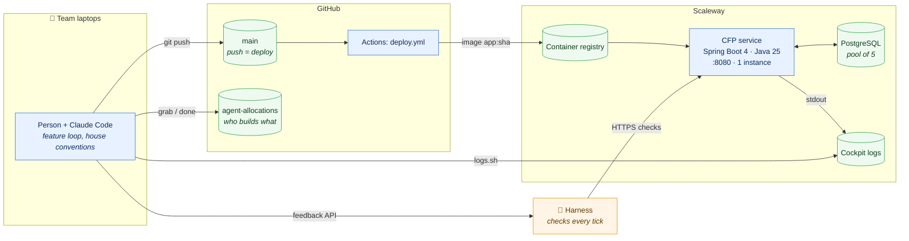
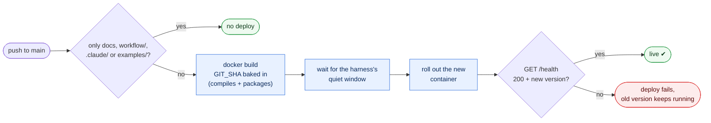
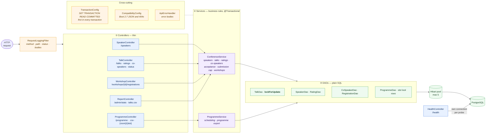
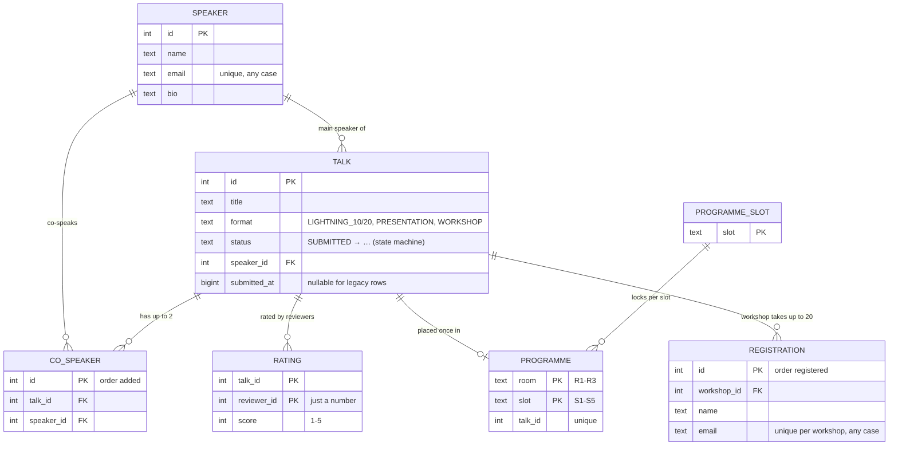
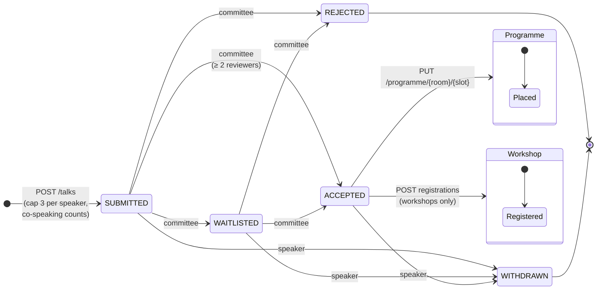
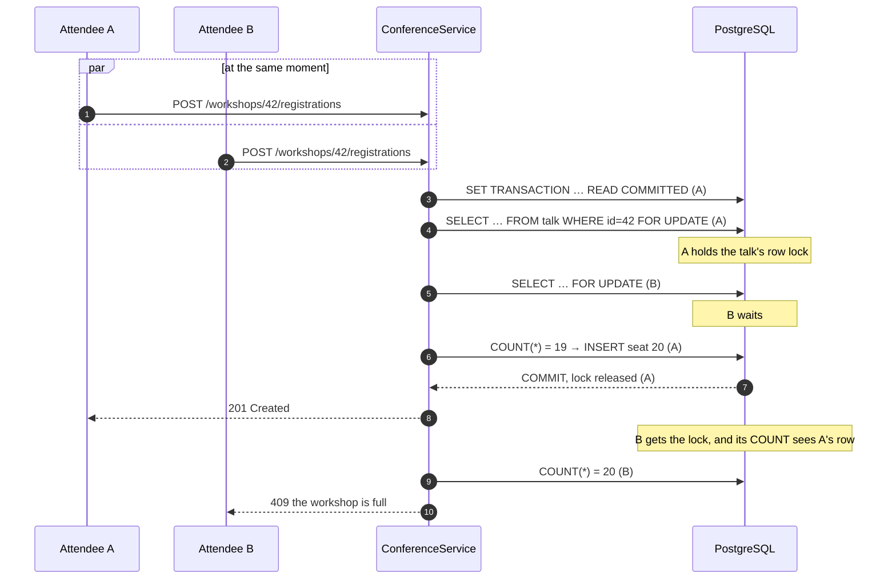

# Architecture

Seven drawings, from the outside in. GitHub renders the Mermaid blocks; rendered SVGs are in
[`workflow/diagrams/`](diagrams/) for anywhere else.

1. [The system: who talks to what](#1-the-system-who-talks-to-what)
2. [From push to production](#2-from-push-to-production)
3. [Inside the service](#3-inside-the-service)
4. [The data model](#4-the-data-model)
5. [A talk's life](#5-a-talks-life)
6. [Concurrency: how a rush stays correct](#6-concurrency-how-a-rush-stays-correct)
7. [How we work: agents, ledger, gates](#7-how-we-work-agents-ledger-gates)

## 1. The system: who talks to what

## 2. From push to production

Every code deploy used to cost about one tick of FAULTY checks; rolling out in the harness's quiet window
removes most of that. Docs-only pushes never deploy. The test suite runs in Actions *after* the deploy and is
not a gate there: our gate is `./mvnw package` (Testcontainers) before a person merges, see drawing 7.

## 3. Inside the service

## 4. The data model

## 5. A talk's life

Anything not drawn is a **409** (including a repeat: WAITLISTED → WAITLISTED). Rejected and withdrawn talks
stop counting towards the speaker's cap.

## 6. Concurrency: how a rush stays correct

Twenty seats, forty attendees at the same instant. The row lock serialises them; READ COMMITTED makes the
count after the lock see every seat taken while we waited.

The same pattern guards co-speakers (max 2), the submission cap (max 3 per speaker; talk lock, then speaker
lock, always in that order), committee decisions, and the programme (a lock row per slot). The 14:07 incident
was this drawing breaking: a leaked REPEATABLE READ made B's count blind to A's row, and 22 attendees got 20
seats.

## 7. How we work: agents, ledger, gates

```mermaid
flowchart LR
    subgraph find["① Find work"]
        direction TB
        watch["👀 Watcher<br/><i>new spec · FAULTY check<br/>free feature · service down</i>"]
        pull["Pull main"]
        grab{"allocate.sh grab<br/><i>compare-and-swap<br/>on the ledger</i>"}
        watch --> pull --> grab
        grab -- "taken" --> watch
    end

    subgraph build["② Build it right"]
        direction TB
        branch["Branch<br/>feature/&lt;slug&gt;"]
        table["Requirements table<br/><i>spec rows + convention rows</i>"]
        impl["Implement + tests<br/><i>concurrency · a test that<br/>fails before the fix</i>"]
        green{"./mvnw package<br/>green?"}
        review{"Independent reviewer<br/><i>sees only spec + diff</i>"}
        branch --> table --> impl --> green
        green -- "no" --> impl
        green -- "yes" --> review
        review -- "gaps" --> impl
    end

    subgraph ship["③ Ship it"]
        direction TB
        report["Test report<br/>+ REVIEW.md log"]
        merge{{"Person: merge<br/><i>deploys</i>"}}
        gate{"Pre-claim gate<br/><i>run.sh + edge cases<br/>on the deployed URL</i>"}
        claim{{"Person: claim<br/>on the harness"}}
        report --> merge --> gate --> claim
    end

    grab -- "ours" --> branch
    review -- "clean" --> report
    claim -. "next" .-> watch

    classDef agent fill:#e8f1ff,stroke:#2f6fdb,color:#0b2a5b
    classDef gatec fill:#fff4e5,stroke:#e69500,color:#5c3b00
    classDef person fill:#f3ecff,stroke:#7a4fd6,color:#2a1259
    class watch,pull,branch,table,impl,report agent
    class grab,green,review,gate gatec
    class merge,claim person
```

Agents never merge, deploy or claim on their own; a person does (the purple steps). Every gate exists
because the deployed service broke without it: see [`house-conventions.md`](../.claude/rules/house-conventions.md)
and REVIEW.md §4.
